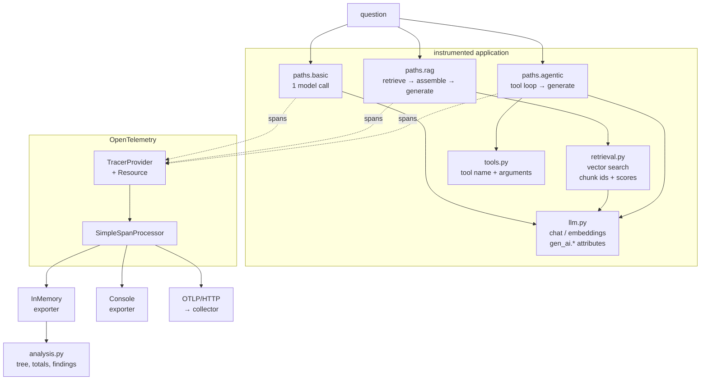

# otel-llm-pipeline-tracing

An LLM request stops being one model call the moment retrieval or tools enter the picture.
This is a small travel advisor with **three execution paths** — plain generation, RAG, and a
tool-calling agent — instrumented end to end with OpenTelemetry, plus the analysis that reads
the spans back and says what went wrong.

```bash
pip install -r requirements.txt

python main.py                   # all three paths, with span trees and findings
python main.py --compare         # the agent bug that costs 3x and never fails
python main.py --exporter otlp   # ship to a real collector instead
pytest -q
```

## The problem

A slow or wrong response can come from the embedding call, the retrieval step, the context
assembly, the generation, or an agent that called the same tool six times. Timing the outer
HTTP request tells you the pipeline was slow. It cannot tell you which part, because from the
outside all three paths in this repository look the same: one question in, one answer out,
a couple hundred milliseconds, HTTP 200.

Tracing fixes the attribution problem. One request is one **trace**. Every stage is a
**span** carrying that trace id, its own timing, its status, and stage-specific attributes.
Then "the answer was wrong" becomes "retrieval returned a top score of 0.04", and "it felt
slow" becomes "the agent ran `lookup_weather(city=kyoto)` six times".

## What the trace looks like

```
advisor.rag                              29.4 ms
  retrieve                               11.7 ms   mean score 0.412
    embeddings advisor-embed-small        4.6 ms   15+0 tok
    vector_search                         3.4 ms   mean score 0.412
  assemble_context                        0.1 ms
  chat advisor-chat-mini                 12.9 ms   102+22 tok
```

Durations and scores vary with the question; the structure does not. The same request through `advisor.basic`
is two spans, and through `advisor.agentic` it is however many the agent decided on.

## The demo worth running

`python main.py --compare` runs the agentic path twice against the same question. The only
difference is whether the loop remembers what it has already called:

|  | remembers | forgets |
|---|---|---|
| tool spans | 2 | 6 |
| distinct tool calls | 2 | 1 |
| errors | 0 | 0 |
| HTTP status | 200 | 200 |

The second run gathers exactly one fact, six times. It does not fail, it does not log an
error, and nothing outside the trace distinguishes it from the first. This is the most common
way an agentic pipeline gets expensive, and span-level tool attribution is what surfaces it —
`find_problems` flags it automatically by grouping tool spans on `(tool name, arguments)`.

## Architecture



Every span in the application is opened with a tracer that is **passed in**, never fetched
from the global provider. The second `set_tracer_provider` call in a process is silently
ignored, so a test suite that configures tracing twice quietly exports into the first run's
collector. One extra argument removes the whole class of bug, and it is why the tests can run
each case against a clean exporter.

## Code map

| File | Responsibility |
|---|---|
| `app/telemetry.py` | `configure(exporter)` builds a `TracerProvider` with a service resource and one of four exporters (`memory`, `console`, `otlp`, `both`), and returns a `Telemetry` handle that can read its own spans back. Also the single home for every attribute key, so the pipeline code contains no attribute string literals. |
| `app/llm.py` | Chat and embedding calls, each one span named `<operation> <model>` with `gen_ai.*` attributes, token counts and a computed cost. The model is deterministic and local so traces are reproducible and no key is needed. |
| `app/retrieval.py` | The corpus, a hashed bag-of-words vector store, and `retrieve()` / `build_context()` — separate spans, because over-stuffed context and bad retrieval look identical from outside and have different fixes. The search span records chunk ids and relevance scores. |
| `app/tools.py` | The three tools the agent can call, each wrapped in a span recording tool name and arguments. Failures are recorded on the span and re-raised, never swallowed. |
| `app/paths.py` | The three execution paths, each opening one root span. `agentic(remember_calls=False)` reproduces the repeated-tool bug on purpose. |
| `app/analysis.py` | Consumes `ReadableSpan` objects: `render_tree` rebuilds the parent/child structure, `summarise` totals spans, tokens, cost and errors, and `find_problems` runs the checks — repeated tool calls, weak retrieval, failed spans, and one stage dominating the request. |
| `main.py` | CLI: pick a path, pick an exporter, print trees and findings. |
| `tests/` | One clean in-memory tracer per test. Covers span counts and nesting per path, GenAI attribute presence, error recording, and every finding. |

## Sending it somewhere real

```bash
export OTEL_EXPORTER_OTLP_ENDPOINT=https://your-collector.example.com
export OTEL_EXPORTER_OTLP_HEADERS='authorization=Api-Token <token>'
python main.py --exporter otlp
```

Those are the standard OpenTelemetry environment variables, so any OTLP-speaking backend
works — a local collector, Jaeger, Tempo, or a commercial APM. Credentials live in the
environment; nothing in this repository reads or stores one. `--exporter both` keeps the
local tree while also shipping.

## Notes and limits

- The model and the corpus are stand-ins. Swapping in a real provider means changing
  `app/llm.py` only; the span structure and attribute names stay put.
- Attribute names follow the OpenTelemetry GenAI semantic conventions where they exist
  (`gen_ai.system`, `gen_ai.operation.name`, `gen_ai.request.model`, `gen_ai.usage.*`).
  Retrieval and tool attributes have no stable convention yet, so they are namespaced under
  `advisor.*` rather than squatting on a name that may be standardised differently.
- `SimpleSpanProcessor` exports on span end, which is what makes the output deterministic.
  Use `BatchSpanProcessor` in anything with real traffic.
- Prompts and completions are **not** recorded as span attributes. That is a deliberate
  default: traces are usually retained longer and read more widely than application logs, and
  prompt bodies routinely contain user data.

## References

- [OpenTelemetry semantic conventions for GenAI](https://opentelemetry.io/docs/specs/semconv/gen-ai/)
- [OpenTelemetry Python](https://opentelemetry.io/docs/languages/python/)
- [Traceloop OpenLLMetry](https://github.com/traceloop/openllmetry) — auto-instrumentation for real LLM SDKs, the shortcut past writing these spans by hand
